# Ads

Finished ads. 9:16 is for Reels, TikTok and Shorts, 4:5 for feeds and LinkedIn, 16:9 for YouTube and the web. Every folder keeps the script and build files that made it, so you can re-cut or re-render.

[India trip ads, round one](#india-trip-ads-round-one) · [Cinematic films for agencies](#cinematic-films-for-agencies) · [Agency reels: list your trips free](#agency-reels-list-your-trips-free) · [The 30 second ad](#the-30-second-ad) · [App-only 25 second ad](#app-only-25-second-ad) · [Product demo film](#product-demo-film) · [App store ad](#app-store-ad)

## India trip ads, round one

`ads/india-2026-11/`  
Still ads for real listed trips (Meghalaya, Mizoram, the Taj) and for trip search, in 4:5 and 9:16. Backgrounds rendered in Blender. Ready, not running yet. Print-size masters in `png/`, raw renders in `blender-renders/`.

<table>
<tr><td align="center" valign="top" width="25%"><a href="india-2026-11/finder-a-45.jpg">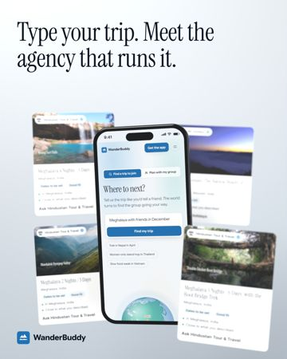</a> finder-a-45.jpg 4:5</td><td align="center" valign="top" width="25%"><a href="india-2026-11/finder-a-916.jpg">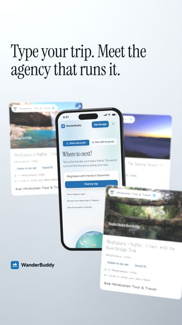</a> finder-a-916.jpg 9:16</td><td align="center" valign="top" width="25%"><a href="india-2026-11/finder-b-45.jpg">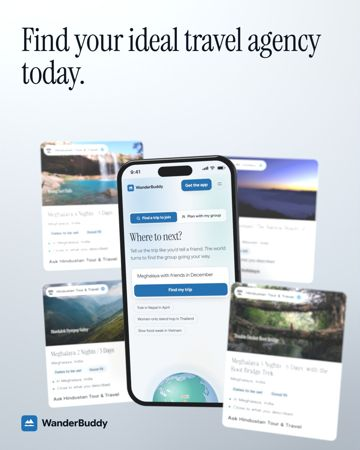</a> finder-b-45.jpg 4:5</td><td align="center" valign="top" width="25%"><a href="india-2026-11/finder-b-916.jpg">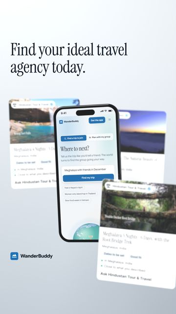</a> finder-b-916.jpg 9:16</td></tr>
<tr><td align="center" valign="top" width="25%"><a href="india-2026-11/mizoram-45.jpg">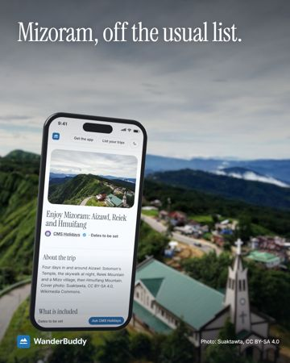</a> mizoram-45.jpg 4:5</td><td align="center" valign="top" width="25%"><a href="india-2026-11/mizoram-916.jpg">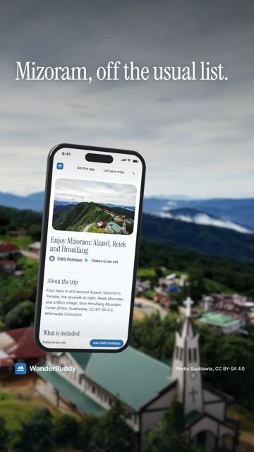</a> mizoram-916.jpg 9:16</td><td align="center" valign="top" width="25%"><a href="india-2026-11/root-bridge-45.jpg">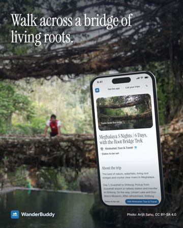</a> root-bridge-45.jpg 4:5</td><td align="center" valign="top" width="25%"><a href="india-2026-11/root-bridge-916.jpg">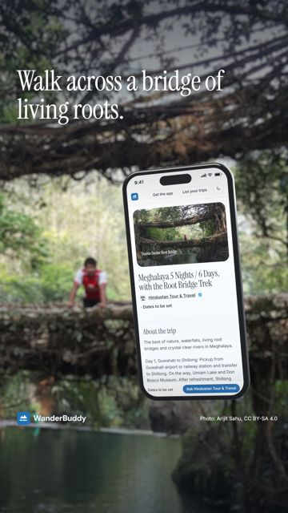</a> root-bridge-916.jpg 9:16</td></tr>
<tr><td align="center" valign="top" width="25%"><a href="india-2026-11/taj-45.jpg">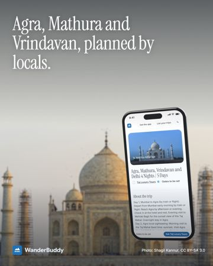</a> taj-45.jpg 4:5</td><td align="center" valign="top" width="25%"><a href="india-2026-11/taj-916.jpg">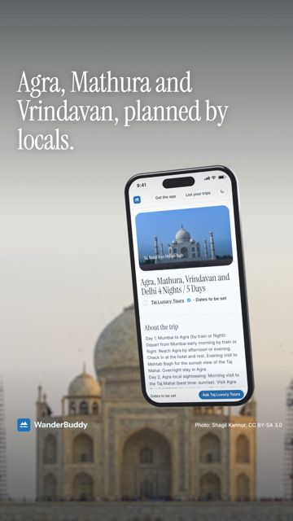</a> taj-916.jpg 9:16</td><td align="center" valign="top" width="25%"><a href="india-2026-11/umngot-45.jpg">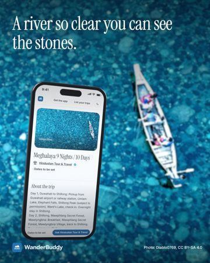</a> umngot-45.jpg 4:5</td><td align="center" valign="top" width="25%"><a href="india-2026-11/umngot-916.jpg">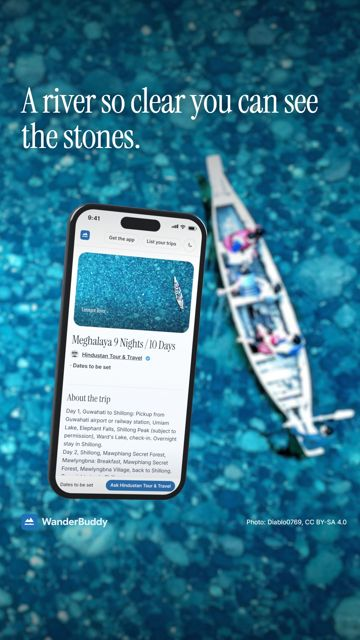</a> umngot-916.jpg 9:16</td></tr>
</table>

Also here: [`blender-renders/`](india-2026-11/blender-renders) (10 files), [`build/`](india-2026-11/build) (8 files), [`png/`](india-2026-11/png) (14 files), [`source/`](india-2026-11/source) (17 files)

## Cinematic films for agencies

`ads/b2b-cinematic/`  
One film per thing we sell an agency, each built on one picture from art or design history, rendered in Blender. Numbered files are the first set, v2 and v3 the current ones. The why and the words are in `TREATMENT.md` and `TREATMENT_V2.md`.

<table>
<tr><td align="center" valign="top" width="25%"><a href="b2b-cinematic/out/1-departures.mp4">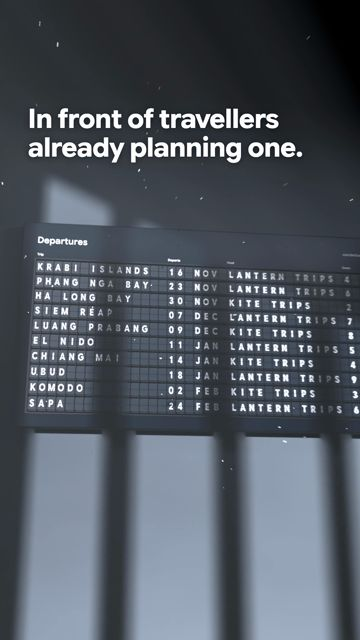</a> ▶ 1-departures.mp4 0:25 · 9:16</td><td align="center" valign="top" width="25%"><a href="b2b-cinematic/out/2-order.mp4">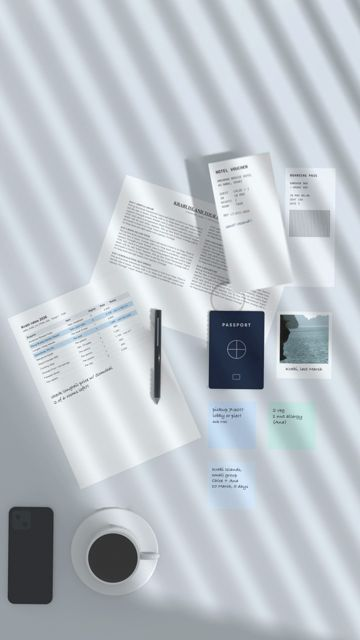</a> ▶ 2-order.mp4 0:25 · 9:16</td><td align="center" valign="top" width="25%"><a href="b2b-cinematic/out/3-2348.mp4">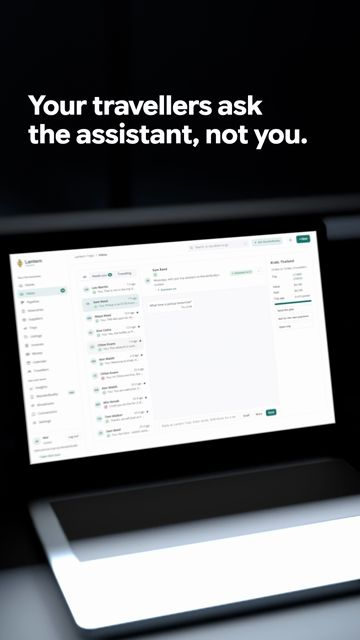</a> ▶ 3-2348.mp4 0:25 · 9:16</td><td align="center" valign="top" width="25%"><a href="b2b-cinematic/out/4-day2.mp4">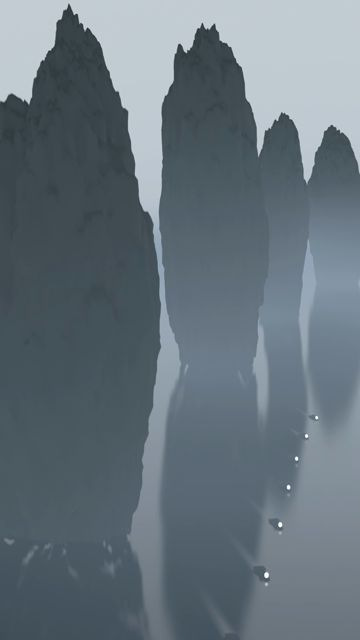</a> ▶ 4-day2.mp4 0:25 · 9:16</td></tr>
<tr><td align="center" valign="top" width="25%"> ▶ v2-day2.mp4 0:25 · 9:16</td><td align="center" valign="top" width="25%"> ▶ v2-monsoon.mp4 0:31 · 9:16</td><td align="center" valign="top" width="25%"><a href="b2b-cinematic/out/v2-opened-3-times.mp4">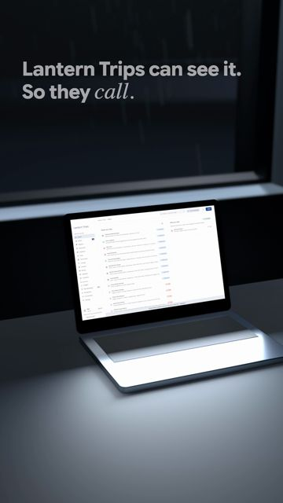</a> ▶ v2-opened-3-times.mp4 0:30 · 9:16</td><td align="center" valign="top" width="25%"><a href="b2b-cinematic/out/v2-the-reel.mp4">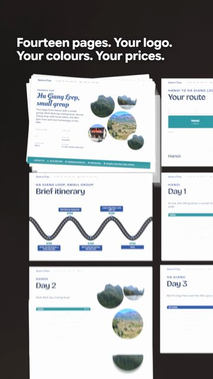</a> ▶ v2-the-reel.mp4 0:35 · 9:16</td></tr>
<tr><td align="center" valign="top" width="25%"><a href="b2b-cinematic/out/v2-three-agencies.mp4">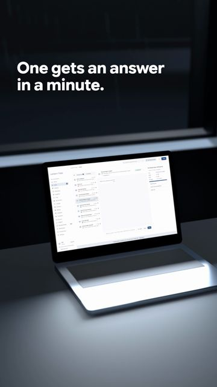</a> ▶ v2-three-agencies.mp4 0:30 · 9:16</td><td align="center" valign="top" width="25%"><a href="b2b-cinematic/out/v3-three-agencies.mp4">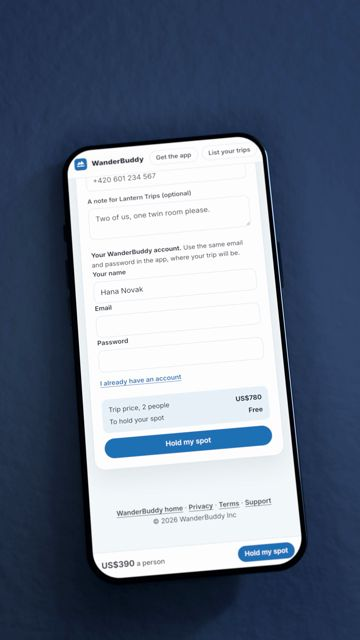</a> ▶ v3-three-agencies.mp4 0:32 · 9:16</td><td align="center" valign="top" width="25%"><a href="b2b-cinematic/out/linkedin/v2-day2_4x5.mp4">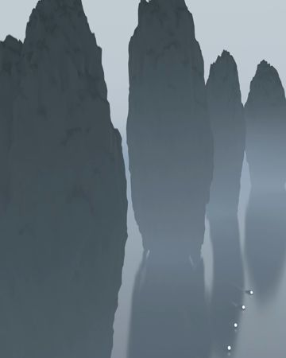</a> ▶ v2-day2_4x5.mp4 0:25 · 4:5</td><td align="center" valign="top" width="25%"> ▶ v2-monsoon_4x5.mp4 0:31 · 4:5</td></tr>
<tr><td align="center" valign="top" width="25%"><a href="b2b-cinematic/out/linkedin/v2-opened-3-times_4x5.mp4">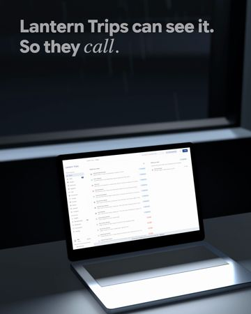</a> ▶ v2-opened-3-times_4x5.mp4 0:30 · 4:5</td><td align="center" valign="top" width="25%"><a href="b2b-cinematic/out/linkedin/v2-the-reel_4x5.mp4">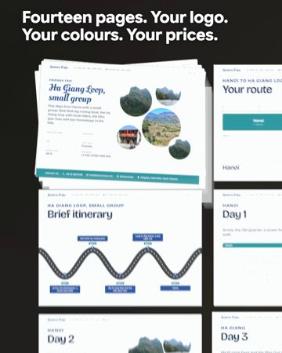</a> ▶ v2-the-reel_4x5.mp4 0:35 · 4:5</td><td align="center" valign="top" width="25%"><a href="b2b-cinematic/out/linkedin/v3-three-agencies_4x5.mp4">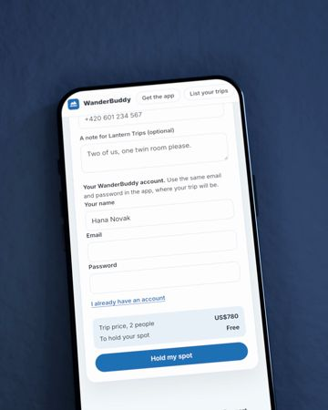</a> ▶ v3-three-agencies_4x5.mp4 0:32 · 4:5</td></tr>
</table>

Also here: [`build/`](b2b-cinematic/build) (67 files), [`HANDOFF.md`](b2b-cinematic/HANDOFF.md), [`MUSIC_SHORTLIST.md`](b2b-cinematic/MUSIC_SHORTLIST.md), [`README.md`](b2b-cinematic/README.md), [`screens/`](b2b-cinematic/screens) (150 files), [`TREATMENT.md`](b2b-cinematic/TREATMENT.md), [`TREATMENT_V2.md`](b2b-cinematic/TREATMENT_V2.md)

## Agency reels: list your trips free

`ads/agency-reels/`  
Three reels for founder-led agencies selling Southeast Asia trips. The pitch: send us your trips, we list them and keep them live. Scripts in `SCRIPTS.md`, end card in `endcard/`.

<table>
<tr><td align="center" valign="top" width="25%"><a href="agency-reels/out/WanderBuddy_B2B_Reel1_WalkIn.mp4">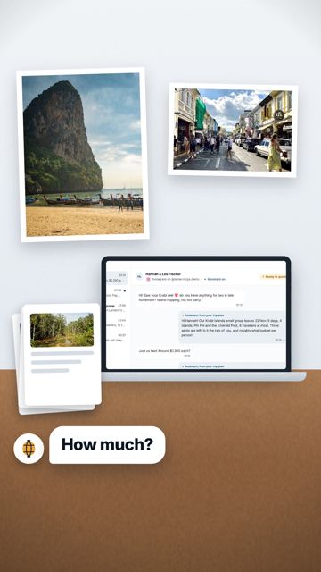</a> ▶ WanderBuddy_B2B_Reel1_WalkIn.mp4 0:36 · 9:16</td><td align="center" valign="top" width="25%"><a href="agency-reels/out/WanderBuddy_B2B_Reel2_Post214.mp4">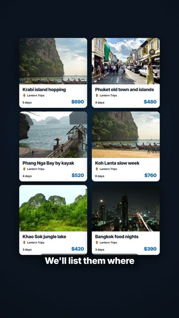</a> ▶ WanderBuddy_B2B_Reel2_Post214.mp4 0:29 · 9:16</td><td align="center" valign="top" width="25%"><a href="agency-reels/out/WanderBuddy_B2B_Reel3_ThreeQuestions.mp4">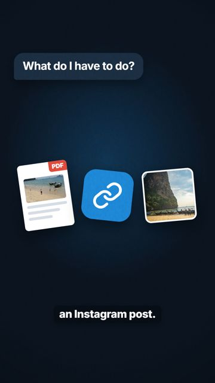</a> ▶ WanderBuddy_B2B_Reel3_ThreeQuestions.mp4 0:32 · 9:16</td><td align="center" valign="top" width="25%"> ▶ endcard.mp4 0:05 · 9:16</td></tr>
<tr><td align="center" valign="top" width="25%"> ▶ endcard_piano.mp4 0:05 · 9:16</td><td align="center" valign="top" width="25%"> ▶ endcard_silent.mp4 0:05 · 9:16</td><td align="center" valign="top" width="25%"> layer-dlnow-shadow.png 9:16</td><td align="center" valign="top" width="25%"> layer-dlnow.png 9:16</td></tr>
<tr><td align="center" valign="top" width="25%"> layer-word-shadow.png 9:16</td><td align="center" valign="top" width="25%"> layer-word.png 9:16</td><td align="center" valign="top" width="25%"> mark_t-shadow.png 1:1</td><td align="center" valign="top" width="25%"> mark_t.png 1:1</td></tr>
</table>

Also here: [`build/`](agency-reels/build) (17 files), [`README.md`](agency-reels/README.md), [`reel1/`](agency-reels/reel1) (19 files), [`REEL1_TAKES.md`](agency-reels/REEL1_TAKES.md), [`SCRIPTS.md`](agency-reels/SCRIPTS.md)

## The 30 second ad

`ads/condensed-25s/`  
The panic of running a trip by hand, then the marketplace, the CRM and the app together. 16:9 and 9:16, plus the first 25 s cut.

<table>
<tr><td align="center" valign="top" width="25%"><a href="condensed-25s/out/wanderbuddy-25s.mp4">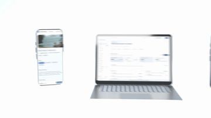</a> ▶ wanderbuddy-25s.mp4 0:25 · 16:9</td><td align="center" valign="top" width="25%"><a href="condensed-25s/out/wanderbuddy-30s.mp4">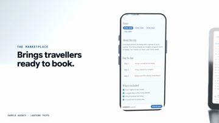</a> ▶ wanderbuddy-30s.mp4 0:30 · 16:9</td><td align="center" valign="top" width="25%"><a href="condensed-25s/out/wanderbuddy-30s_9x16.mp4">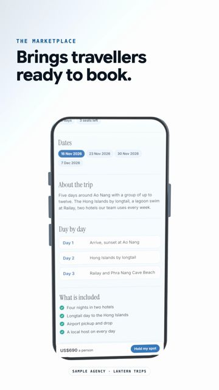</a> ▶ wanderbuddy-30s_9x16.mp4 0:30 · 9:16</td></tr>
</table>

Also here: [`audio/`](condensed-25s/audio) (1 file), [`build/`](condensed-25s/build) (10 files), [`cards/`](condensed-25s/cards) (39 files), [`README.md`](condensed-25s/README.md), [`screens/`](condensed-25s/screens) (15 files)

## App-only 25 second ad

`ads/app-25s/`  
The same story told for travellers, app only.

<table>
<tr><td align="center" valign="top" width="25%"><a href="app-25s/app-25s-travellers-9x16.mp4">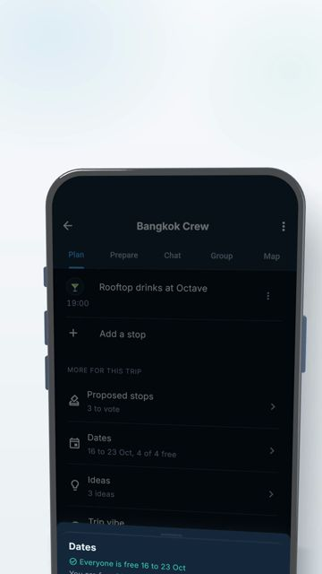</a> ▶ app-25s-travellers-9x16.mp4 0:25 · 9:16</td><td align="center" valign="top" width="25%"><a href="app-25s/app-25s.mp4">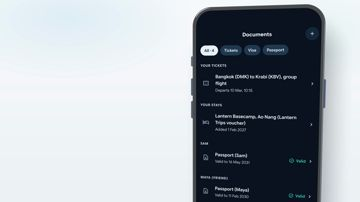</a> ▶ app-25s.mp4 0:25 · 16:9</td></tr>
</table>

Also here: [`audio/`](app-25s/audio) (6 files), [`build/`](app-25s/build) (5 files), [`grounds/`](app-25s/grounds) (4 files), [`README.md`](app-25s/README.md), [`screens/`](app-25s/screens) (15 files)

## Product demo film

`ads/investor-demo/`  
"One app, both ways to run a trip": a 2 minute walk through the app and the CRM, and an 86 s agency-only cut. Script in `SCRIPT.md`.

<table>
<tr><td align="center" valign="top" width="25%"><a href="investor-demo/out/wanderbuddy-investor-demo.mp4">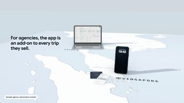</a> ▶ wanderbuddy-investor-demo.mp4 1:59 · 16:9</td><td align="center" valign="top" width="25%"><a href="investor-demo/out/wanderbuddy-investor-demo_agency-only.mp4">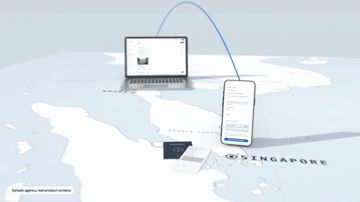</a> ▶ wanderbuddy-investor-demo_agency-only.mp4 1:26 · 16:9</td></tr>
</table>

Also here: [`build/`](investor-demo/build) (9 files), [`README.md`](investor-demo/README.md), [`screens/`](investor-demo/screens) (47 files), [`SCRIPT.md`](investor-demo/SCRIPT.md)

## App store ad

`ads/store-ad/`  
One-page ad for the app, PNG and PDF.

<table>
<tr><td align="center" valign="top" width="25%"><a href="store-ad/wanderbuddy-store-ad.png">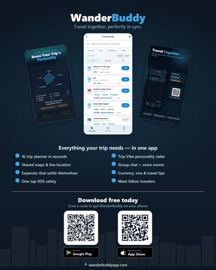</a> wanderbuddy-store-ad.png 4:5</td></tr>
</table>

Also here: [`wanderbuddy-store-ad.pdf`](store-ad/wanderbuddy-store-ad.pdf)
