# AI generated

Raw AI footage and stills to cut into new edits, made with Higgsfield, Kling and Seedance. Prompts and notes are in `prompts/`. Use AI shots for mood only, never to show a trip someone can actually buy.

[Cinematic ad plates](#cinematic-ad-plates) · [Travesty shots](#travesty-shots) · [Trip People shots](#trip-people-shots)

## Cinematic ad plates

`ai-generated/higgsfield-cinematic-ad/`  
Nine shots: Higgsfield Soul Cinematic stills animated in Kling 3.0, 1080p, 9:16, silent. The phone screens are blank azure plates on purpose: track the real UI from `screens/` onto them. The edit sheet is `CINEMATIC_AD_COMP_MAP.md`.

<table>
<tr><td align="center" valign="top" width="25%"><a href="higgsfield-cinematic-ad/clips/01_alpine.mp4">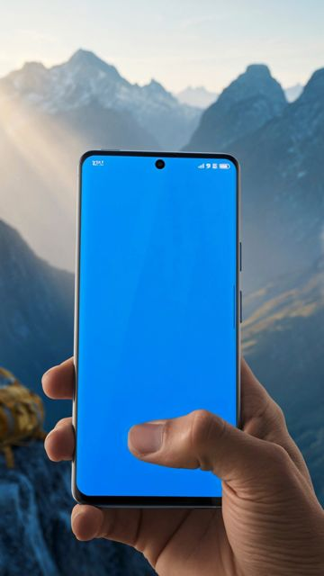</a> ▶ 01_alpine.mp4 0:05 · 9:16</td><td align="center" valign="top" width="25%"><a href="higgsfield-cinematic-ad/clips/02_beach.mp4">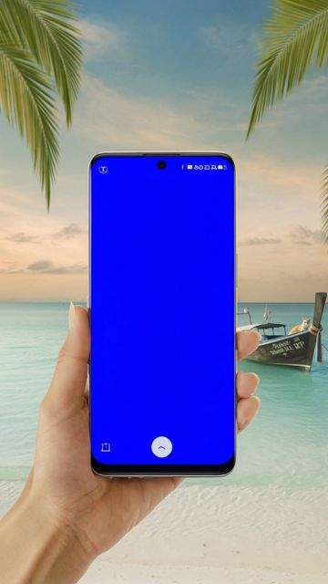</a> ▶ 02_beach.mp4 0:05 · 9:16</td><td align="center" valign="top" width="25%"><a href="higgsfield-cinematic-ad/clips/03_tokyo.mp4">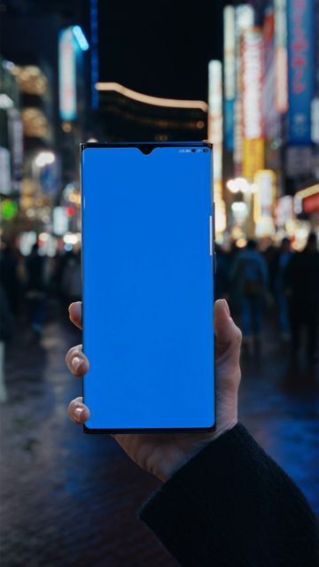</a> ▶ 03_tokyo.mp4 0:05 · 9:16</td><td align="center" valign="top" width="25%"><a href="higgsfield-cinematic-ad/clips/04_market.mp4">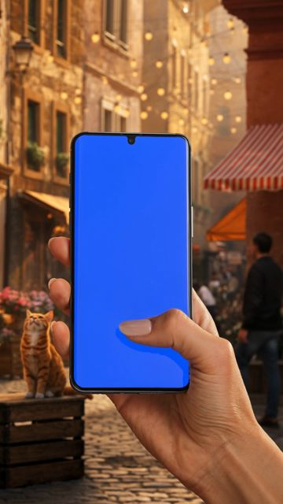</a> ▶ 04_market.mp4 0:05 · 9:16</td></tr>
<tr><td align="center" valign="top" width="25%"><a href="higgsfield-cinematic-ad/clips/05_group_budget.mp4">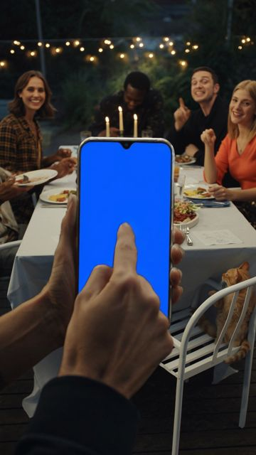</a> ▶ 05_group_budget.mp4 0:05 · 9:16</td><td align="center" valign="top" width="25%"><a href="higgsfield-cinematic-ad/clips/06_train_liveconv.mp4">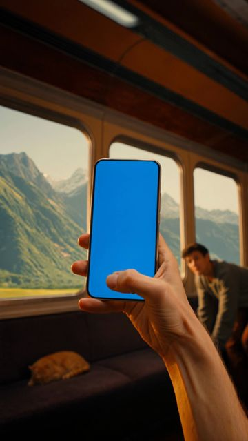</a> ▶ 06_train_liveconv.mp4 0:05 · 9:16</td><td align="center" valign="top" width="25%"><a href="higgsfield-cinematic-ad/clips/07_desert.mp4">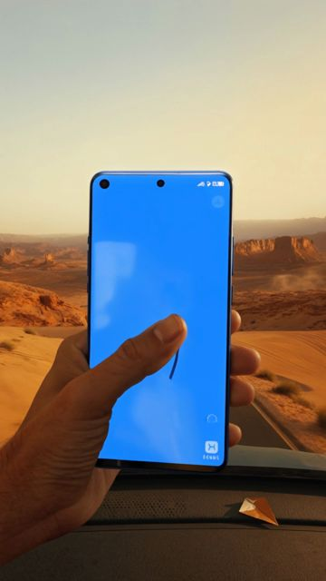</a> ▶ 07_desert.mp4 0:05 · 9:16</td><td align="center" valign="top" width="25%"><a href="higgsfield-cinematic-ad/clips/08_rooftop.mp4">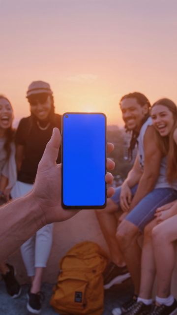</a> ▶ 08_rooftop.mp4 0:05 · 9:16</td></tr>
<tr><td align="center" valign="top" width="25%"><a href="higgsfield-cinematic-ad/clips/09_ending.mp4">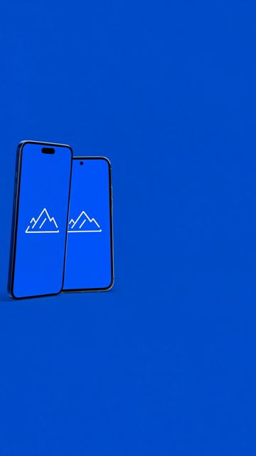</a> ▶ 09_ending.mp4 0:05 · 9:16</td><td align="center" valign="top" width="25%"><a href="higgsfield-cinematic-ad/stills/01_alpine.png">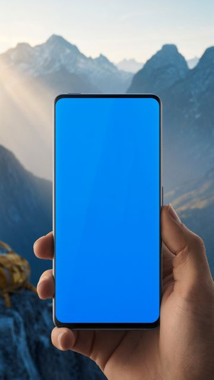</a> 01_alpine.png 9:16</td><td align="center" valign="top" width="25%"><a href="higgsfield-cinematic-ad/stills/02_beach.png">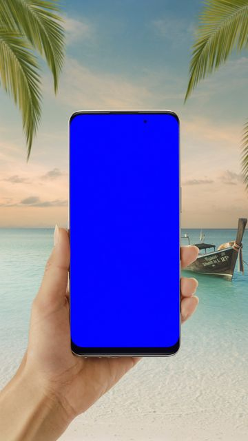</a> 02_beach.png 9:16</td><td align="center" valign="top" width="25%"><a href="higgsfield-cinematic-ad/stills/05_group_budget.png">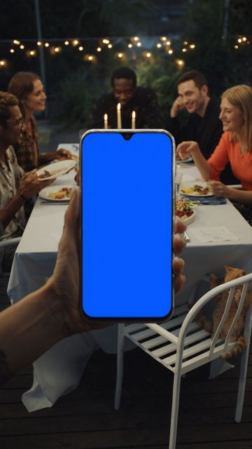</a> 05_group_budget.png 9:16</td></tr>
<tr><td align="center" valign="top" width="25%"><a href="higgsfield-cinematic-ad/stills/06_train_liveconv.png">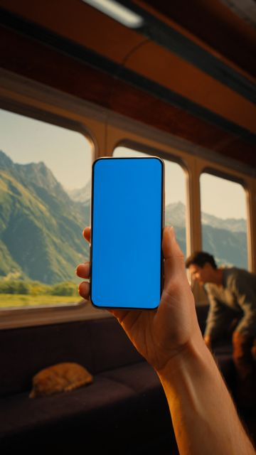</a> 06_train_liveconv.png 9:16</td><td align="center" valign="top" width="25%"><a href="higgsfield-cinematic-ad/stills/09_ending.png">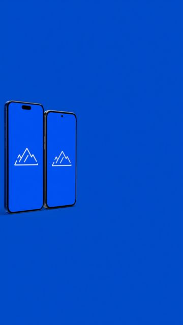</a> 09_ending.png 9:16</td></tr>
</table>

Also here: [`CINEMATIC_AD_COMP_MAP.md`](higgsfield-cinematic-ad/CINEMATIC_AD_COMP_MAP.md), [`README.txt`](higgsfield-cinematic-ad/README.txt), [`screens/`](higgsfield-cinematic-ad/screens) (9 files)

## Travesty shots

`ai-generated/travesty-kling-shots/`  
Every shot of Travesty as its own 5 second Kling clip, plus the Higgsfield stills behind them.

[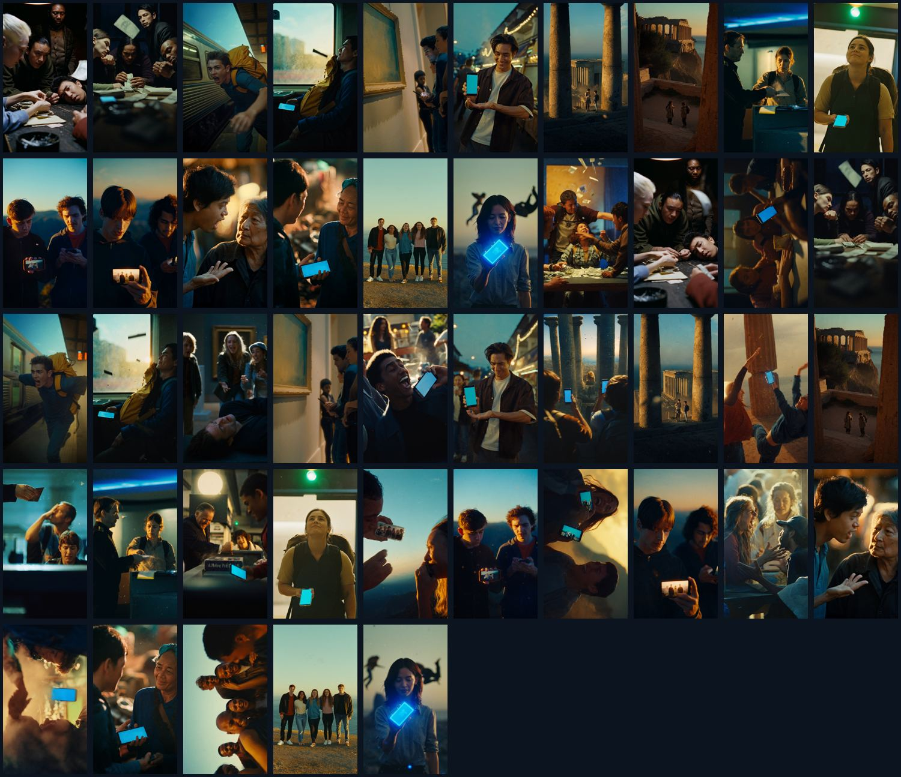](travesty-kling-shots/)

45 files. Open the folder to download any of them.

## Trip People shots

`ai-generated/trip-people-seedance-shots/`  
All the Seedance shots behind the Trip People series.

[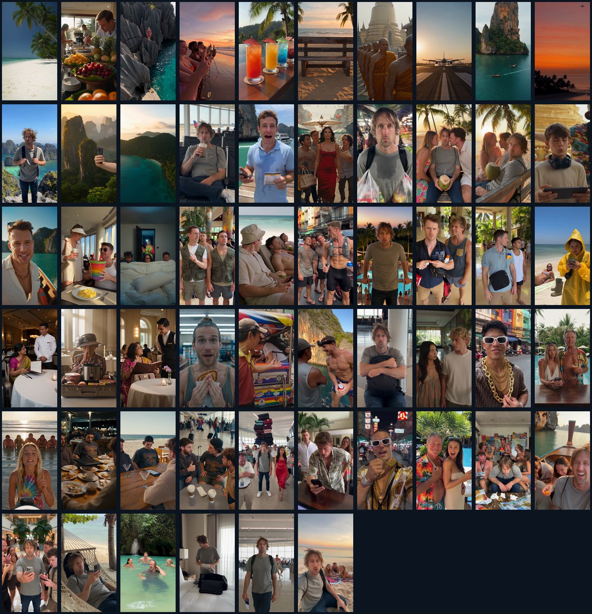](trip-people-seedance-shots/)

56 files. Open the folder to download any of them.
