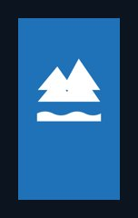
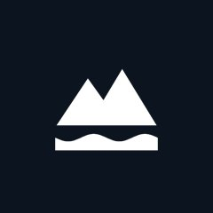
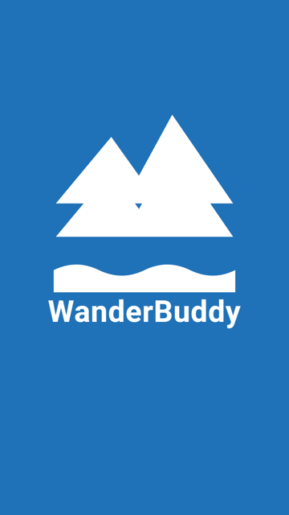
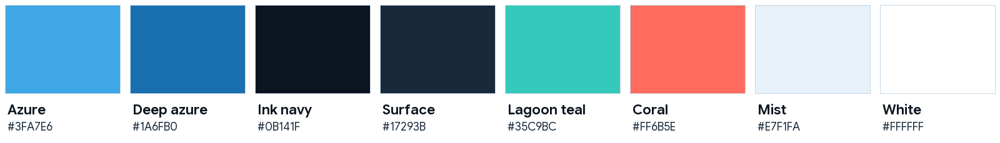
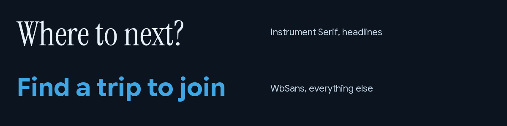

# Brand

Everything you need to make something that looks and sounds like WanderBuddy.

 &nbsp;  &nbsp;  &nbsp; 

| Folder | What is in it |
|---|---|
| [`logo/`](logo) | App icon, the mark, the white glyph, the logo card, and `icon-master.svg` (the vector master) |
| [`qr/`](qr) | QR code to wanderbuddyapp.com, PNG and SVG |
| [`fonts/`](fonts) | WbSans (our typeface, open licence), Instrument Serif for headlines, Inter |
| [`mascot/`](mascot) | The gentleman and the lady: poses, sheets, directions and a short animation |
| [`destination-photos/`](destination-photos) | The trip banner photos used in the app |
| [`music/`](music) | The bossa nova bed and the single piano notes every reel is scored with, with licences |
| [`brand-codex/`](brand-codex) | The full brand codex page. Open `brand-codex.html` in a browser |

## Colour

Azure on ink navy, with lagoon teal. Dark is home, light works too. Coral is for warnings only.
**No yellow and no amber**, anywhere.

## Type

## Sound

Real recordings only: the bossa nova bed and the piano notes in [`music/`](music).
No synthesized music, chimes or whooshes, and no AI voices pitched up or down.

## The rules

1. **The host is the brand.** On anything about a trip, the agency comes first: their name, logo and tick. WanderBuddy is the credit line.
2. **Only what is live.** Show and say only what ships today. Never market a feature that is not out.
3. **Real, never generated-looking.** Real app screens, real photos from real departures. AI and stock footage set a mood; they never stand in for a trip someone can buy.
4. **One thing at a time.** One headline per frame. No small label above it, no grey line under it.
5. **Calm.** Solid backgrounds, no glow. The excitement comes from the trip, not the design.

## Copy

- No em dashes. No exclamation marks. No italics.
- One headline, no subtext. Lead with the group and the trip, not "AI".
- Prices in USD. Never put agency prices in an ad; send people to a call.
- Southeast Asia first. "Solo-friendly", never "solo-first".
- On sales pages, say "our team" or "our founder", not names.
