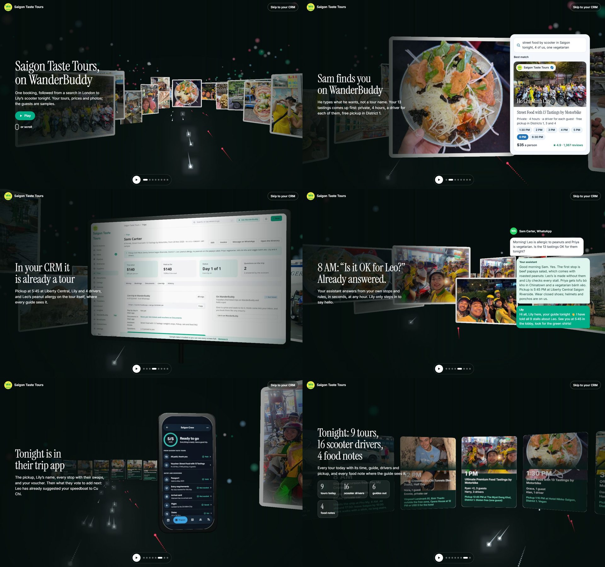

# Demos

## Open demo, no login

**https://wanderbuddyapp.com/trydemo**

The real CRM, loaded with a sample agency in Krabi. Click anything: the inbox, itineraries, listings, payments, the trip app. It resets on its own, so you cannot break it.

On **https://wanderbuddyapp.com/partners**, "Try the demo" asks for an agency's name and logo and opens the same demo in that agency's brand. Handy for content and pitches.

## Personalised agency demos

Built for real agencies we are talking to, with their own tours, photos and prices loaded into the live CRM. Saigon Taste Tours is the newest and the template for every demo from now on: it opens with a 3D story through the agency's own photos that follows one booking from the marketplace to the guests' trip app, then drops into the CRM.

| Agency | Where | Demo |
|---|---|---|
| Saigon Taste Tours | Ho Chi Minh City, food tours | wanderbuddyapp.com/saigontastedemo |
| Forest Retreat Laos | Laos | wanderbuddyapp.com/forestretreatdemo |
| Phou Iu Travel & Ecotourism | Luang Namtha, Laos | wanderbuddyapp.com/phouiudemo |
| Nature Fun Adventure | Kathmandu, Nepal | wanderbuddyapp.com/naturefundemo |
| Rinjani Sharing Trip | Senaru, Lombok | wanderbuddyapp.com/rinjanidemo |

These sit behind a login made for each agency, and every sign-in is recorded so we know when the agency has looked. Ask us for a walkthrough or your own viewing login. Please never use the agency's login.

## The product on film

If you want the whole thing in two minutes, watch [`ads/investor-demo`](../ads/investor-demo) first, then [`ads/condensed-25s`](../ads/condensed-25s) for the 30 second version.
