# How it works

WanderBuddy is three products that feed each other: an **app** for travellers, a **CRM** for travel agencies, and a **marketplace** where agencies list trips and travellers book them.

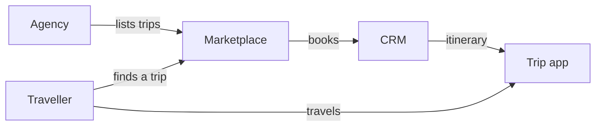

## The loop

1. An agency lists a trip on WanderBuddy. Listing is free.
2. We bring travellers to it: the website, trip search, and our ads. That last part is where you come in.
3. A traveller asks a question or holds a spot. It lands in the agency's CRM inbox, and the assistant answers in seconds.
4. The agency confirms, sends a branded itinerary and takes payment, all from the CRM.
5. The guests join the trip in the app and travel with it: chat, plan, map, costs.

WanderBuddy earns a fee only when a traveller books.

---

## 1. The app, for travellers

One place for the whole group: chat, vote on plans, a shared itinerary, a live map, split costs, a vault for tickets and passports, and Live Conversation, where everyone speaks their own language. Forward the reels you saved on Instagram and get a real plan back. Free on iPhone and Android.

<table><tr>
<td align="center">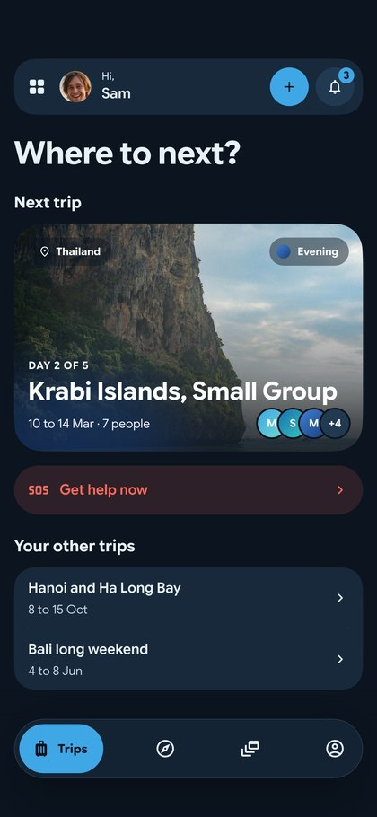 Home</td>
<td align="center">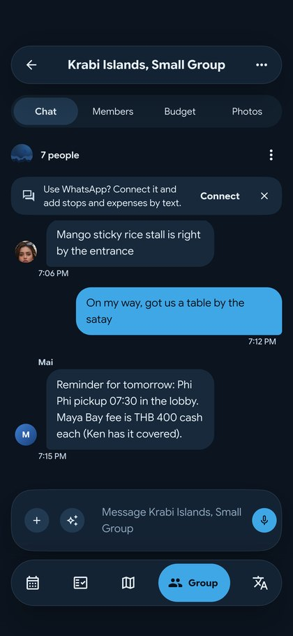 Group chat</td>
<td align="center">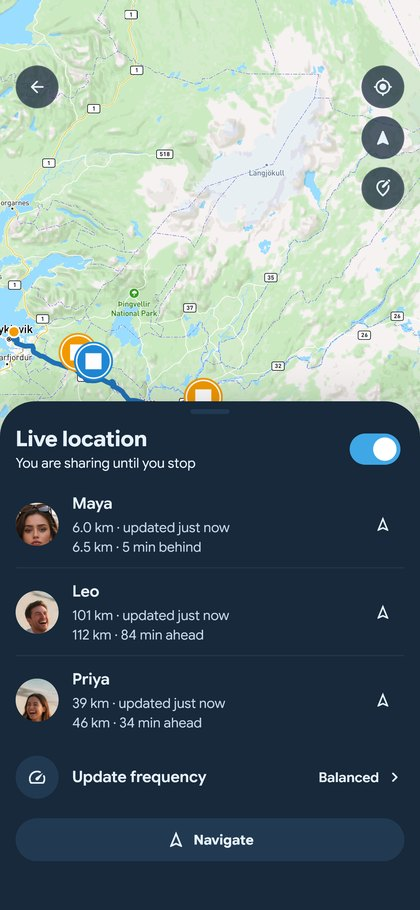 Live map</td>
<td align="center">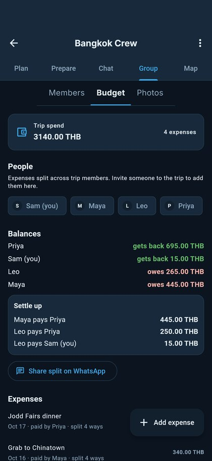 Split costs</td>
<td align="center">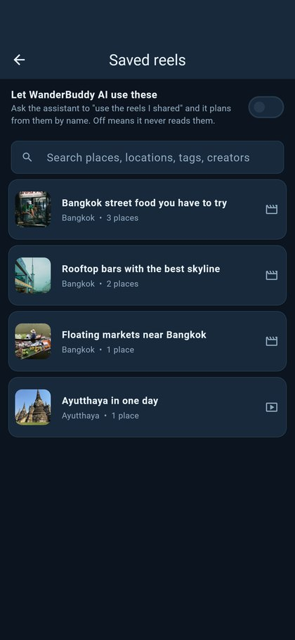 Saved reels into a plan</td>
</tr></table>

## 2. The CRM, for agencies

Where an agency runs its business. Every agency gets its own branded address, like `wanderbuddyapp.com/<agency>crm`. It is sold in three parts, and most agencies take all three:

- **CRM and itinerary maker.** Leads, bookings, payments, calendar, and beautiful PDF itineraries in the agency's brand.
- **The assistant.** AI on the agency's own WhatsApp and Instagram that answers travellers and hands over to a person.
- **The app dashboard.** The agency's guests get the trip app, and the agency sees who joined and how the trip is going.

<table><tr>
<td align="center">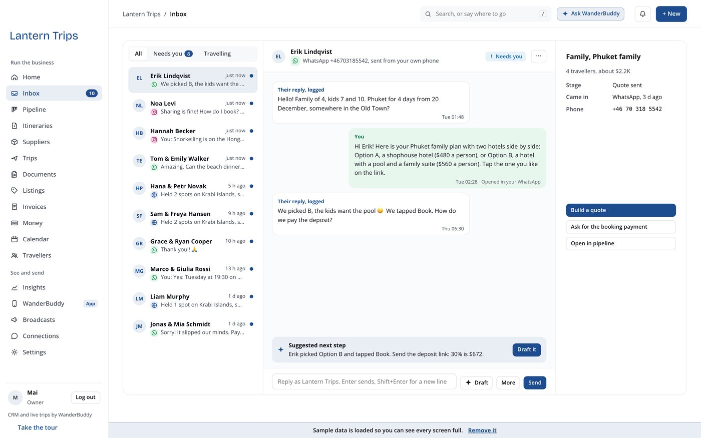 Inbox with the assistant</td>
<td align="center">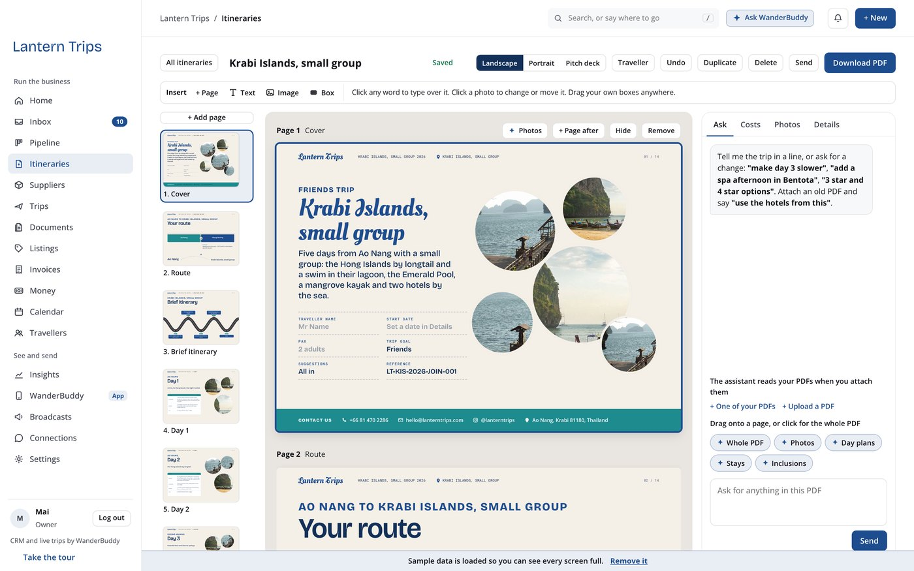 Itinerary maker</td>
</tr><tr>
<td align="center">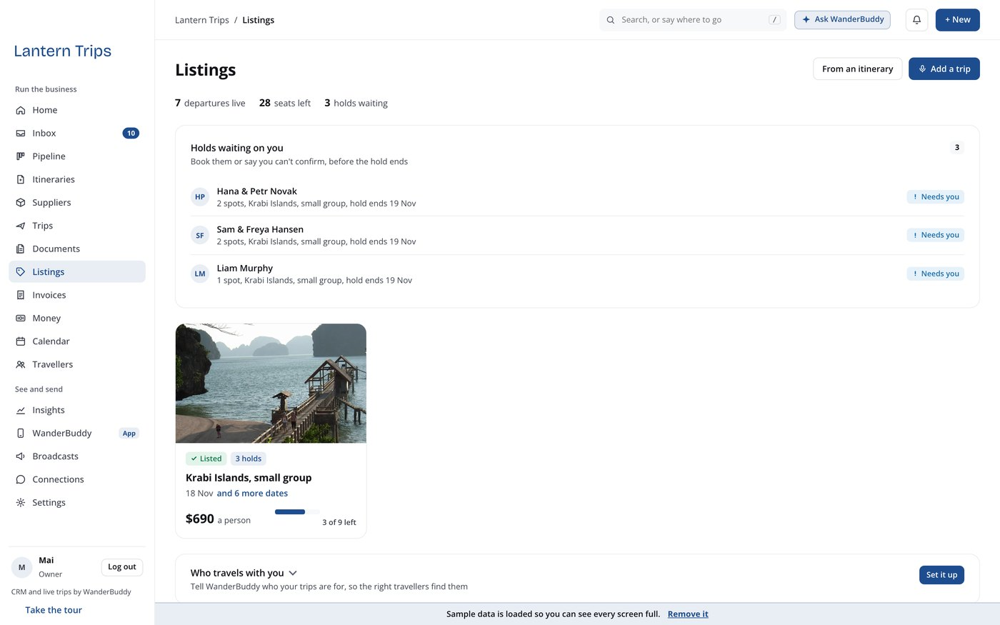 Listings and holds</td>
<td align="center">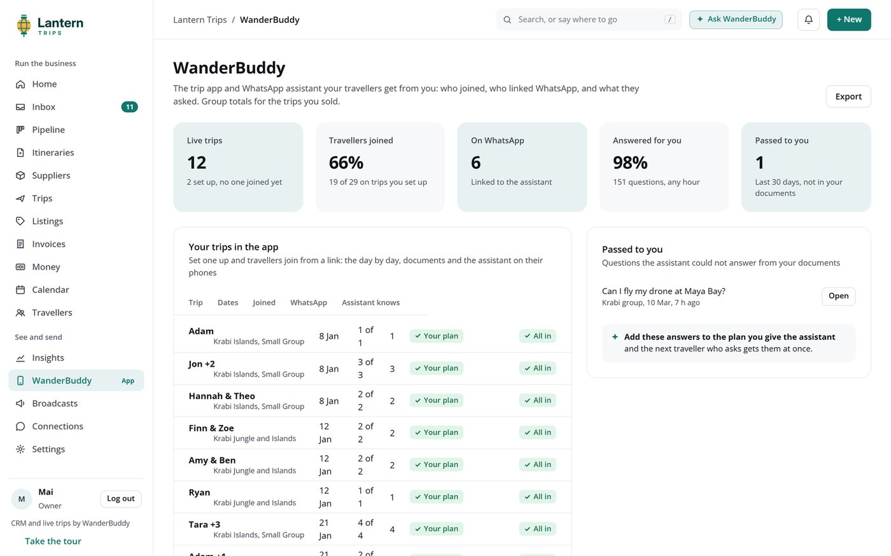 Who joined the trip app</td>
</tr></table>

## 3. The marketplace, for both

Travellers describe the trip they want in their own words ("a beach week in Bali under US$900") and see group trips that fit, run by real agencies. They ask, hold a spot or book. Agencies list for free and pay a small fee only when a traveller books.

<table><tr>
<td align="center">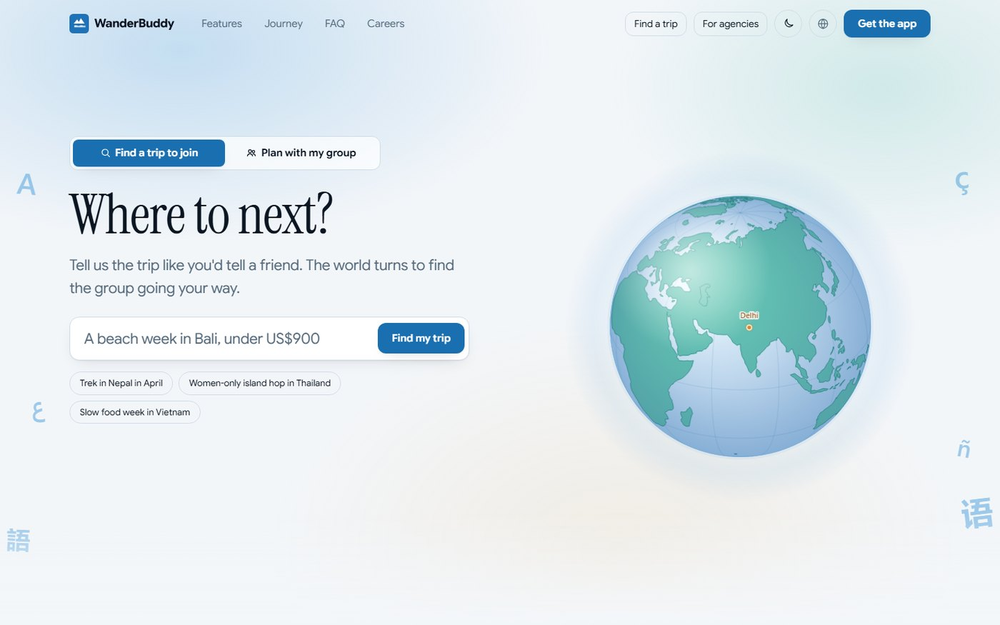 wanderbuddyapp.com</td>
<td align="center">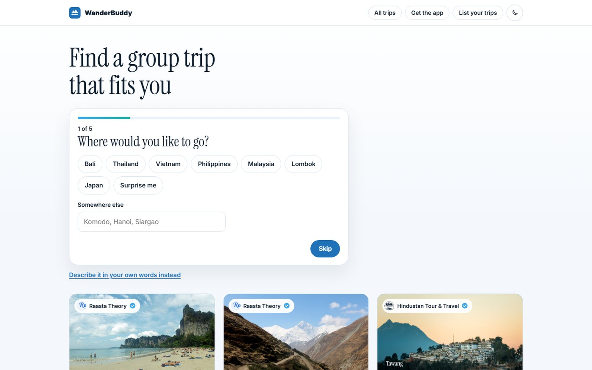 Find a group trip</td>
</tr><tr>
<td align="center">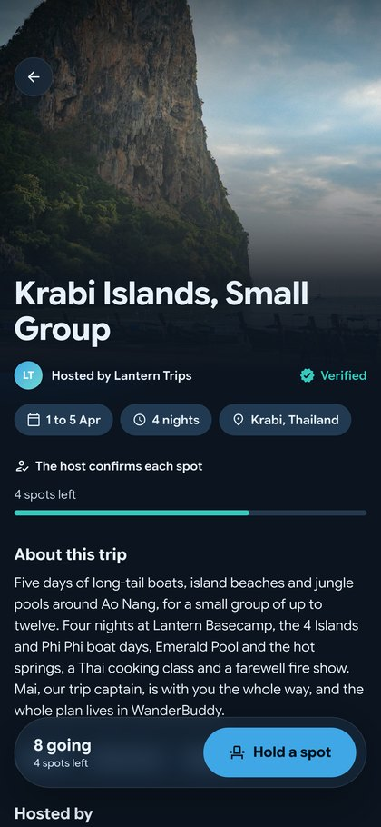 A trip page, on the phone</td>
<td align="center">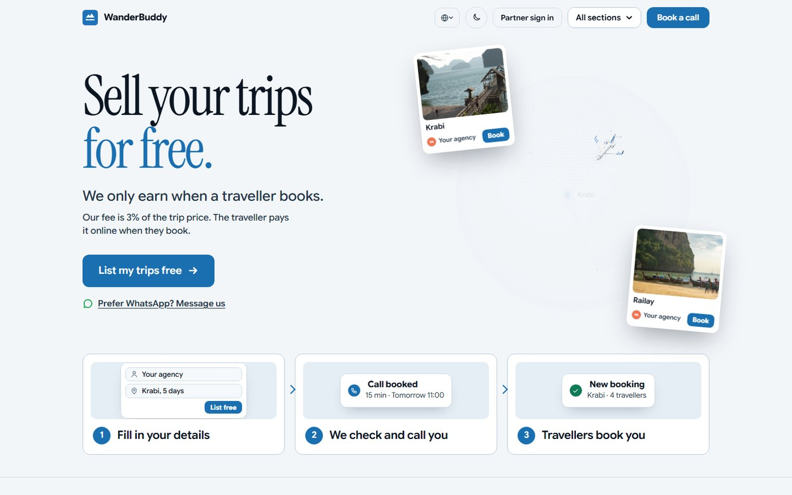 For agencies: sell your trips free</td>
</tr></table>

## Live links

| | |
|---|---|
| Website | https://wanderbuddyapp.com |
| Find a trip | https://wanderbuddyapp.com/trips |
| For agencies | https://wanderbuddyapp.com/partners |
| Agencies book a call | https://wanderbuddyapp.com/partners/call |
| CRM demo, no login | https://wanderbuddyapp.com/trydemo |
| App Store | https://apps.apple.com/app/id6795848498 |
| Google Play | https://play.google.com/store/apps/details?id=com.wanderbuddy.wanderbuddy |

The long version of all this, on film: [`ads/investor-demo`](../ads/investor-demo) (2 minutes) and [`films/launch-film`](../films/launch-film).
