# Reels

Organic short videos, mostly 9:16 with captions burned in. Masters only; the editing sources sit next to each one.

[The people you meet on every trip](#the-people-you-meet-on-every-trip) · [Travesty](#travesty) · [Saved reels into a real plan](#saved-reels-into-a-real-plan) · [I could never overthink my trip](#i-could-never-overthink-my-trip) · [Feature walkthrough](#feature-walkthrough) · [The founder story](#the-founder-story) · [How we got to revenue](#how-we-got-to-revenue) · [Trek UGC](#trek-ugc) · [Group trip explainer](#group-trip-explainer) · [Before and after](#before-and-after) · [Founder meme edits](#founder-meme-edits)

## The people you meet on every trip

`reels/trip-people/`  
Comedy series in three parts, made with AI video (Seedance). Each part comes as the regular cut, a 60 s cut and a longer documentary cut. "Kinds of Travellers" is the newest version. Scripts in `SCRIPT*.md`, characters and keyframes in their folders, all raw shots in `ai-generated/trip-people-seedance-shots`.

<table>
<tr><td align="center" valign="top" width="25%"><a href="trip-people/Kinds_of_Travellers_Pt1.mp4">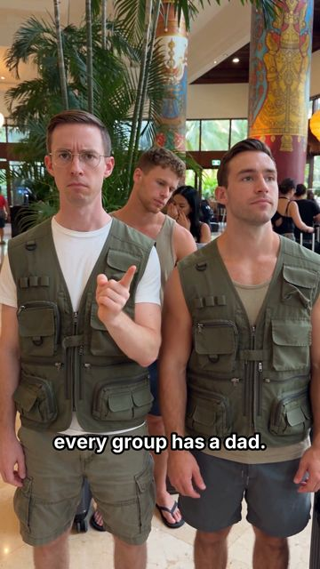</a> ▶ Kinds_of_Travellers_Pt1.mp4 1:08 · 9:16</td><td align="center" valign="top" width="25%"><a href="trip-people/Kinds_of_Travellers_Pt2.mp4">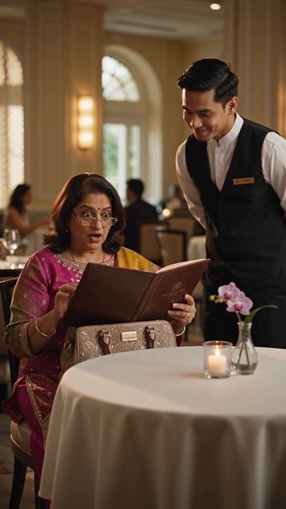</a> ▶ Kinds_of_Travellers_Pt2.mp4 1:17 · 9:16</td><td align="center" valign="top" width="25%"><a href="trip-people/Kinds_of_Travellers_Pt3.mp4">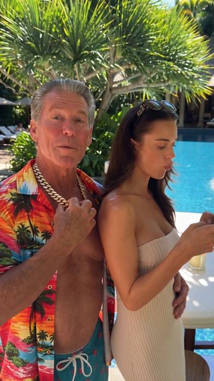</a> ▶ Kinds_of_Travellers_Pt3.mp4 1:18 · 9:16</td><td align="center" valign="top" width="25%"><a href="trip-people/Trip_People_Pt1.mp4">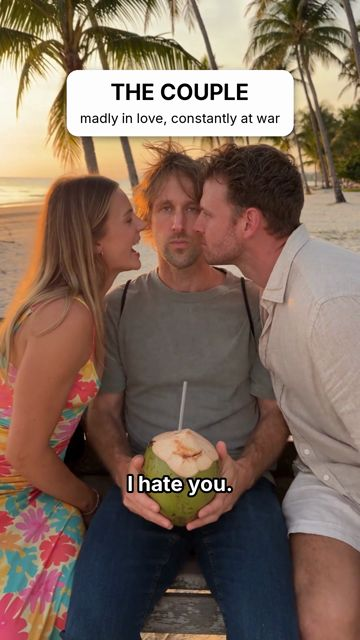</a> ▶ Trip_People_Pt1.mp4 1:16 · 9:16</td></tr>
<tr><td align="center" valign="top" width="25%"><a href="trip-people/Trip_People_Pt1_60.mp4">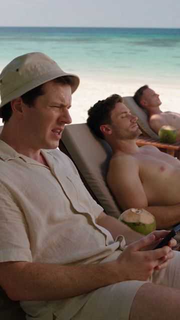</a> ▶ Trip_People_Pt1_60.mp4 1:03 · 9:16</td><td align="center" valign="top" width="25%"><a href="trip-people/Trip_People_Pt1_doc.mp4">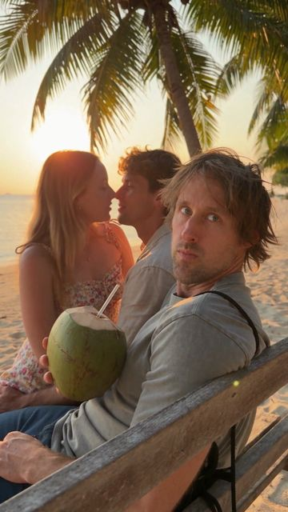</a> ▶ Trip_People_Pt1_doc.mp4 1:52 · 9:16</td><td align="center" valign="top" width="25%"><a href="trip-people/Trip_People_Pt2.mp4">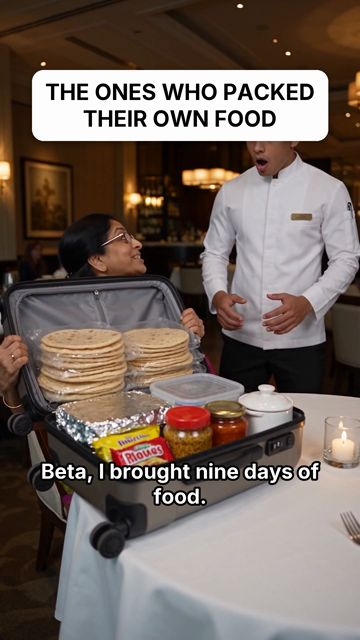</a> ▶ Trip_People_Pt2.mp4 1:20 · 9:16</td><td align="center" valign="top" width="25%"><a href="trip-people/Trip_People_Pt2_60.mp4">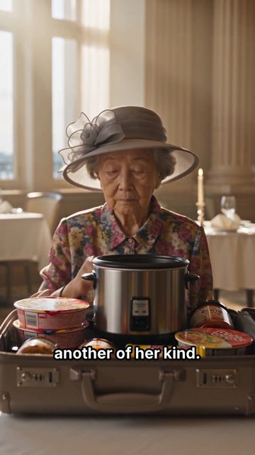</a> ▶ Trip_People_Pt2_60.mp4 1:01 · 9:16</td></tr>
<tr><td align="center" valign="top" width="25%"><a href="trip-people/Trip_People_Pt2_doc.mp4">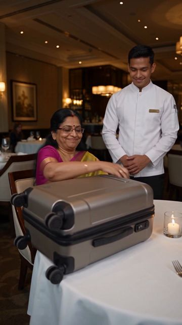</a> ▶ Trip_People_Pt2_doc.mp4 1:58 · 9:16</td><td align="center" valign="top" width="25%"><a href="trip-people/Trip_People_Pt3.mp4">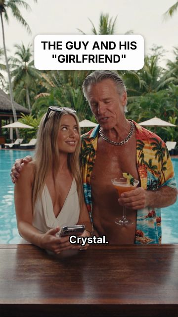</a> ▶ Trip_People_Pt3.mp4 1:14 · 9:16</td><td align="center" valign="top" width="25%"><a href="trip-people/Trip_People_Pt3_60.mp4">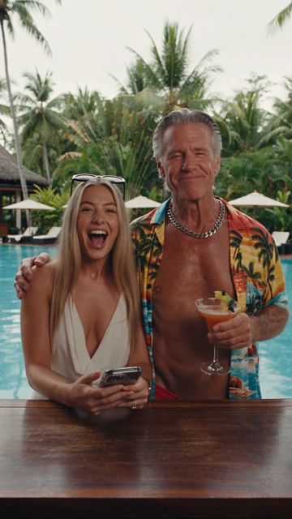</a> ▶ Trip_People_Pt3_60.mp4 1:04 · 9:16</td><td align="center" valign="top" width="25%"><a href="trip-people/Trip_People_Pt3_doc.mp4">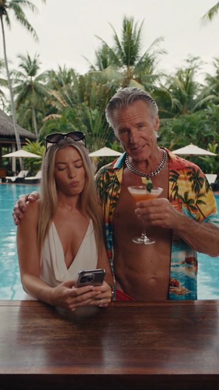</a> ▶ Trip_People_Pt3_doc.mp4 1:53 · 9:16</td></tr>
</table>

Also here: [`build/`](trip-people/build) (62 files), [`characters/`](trip-people/characters) (3 files), [`keyframes/`](trip-people/keyframes) (24 files), [`README.md`](trip-people/README.md), [`SCRIPT.md`](trip-people/SCRIPT.md), [`SCRIPT_v4.md`](trip-people/SCRIPT_v4.md), [`SCRIPT_v5.md`](trip-people/SCRIPT_v5.md)

## Travesty

`reels/travesty/`  
A world frozen mid travel disaster; one traveller downloads WanderBuddy and an azure wave un-breaks everything. Higgsfield stills animated in Kling. The music is a placeholder: read `HANDOFF.md` before posting.

<table>
<tr><td align="center" valign="top" width="25%"> endcard.png 9:16</td><td align="center" valign="top" width="25%"><a href="travesty/WanderBuddy_Travesty_demo.mp4">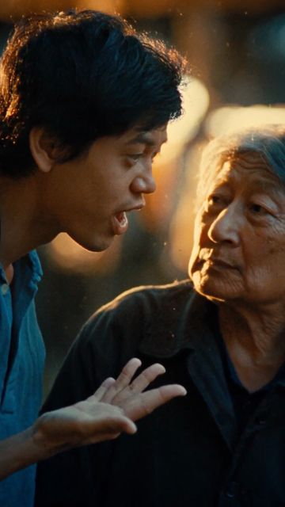</a> ▶ WanderBuddy_Travesty_demo.mp4 0:50 · 9:16</td><td align="center" valign="top" width="25%"><a href="travesty/WanderBuddy_Travesty_reel.mp4">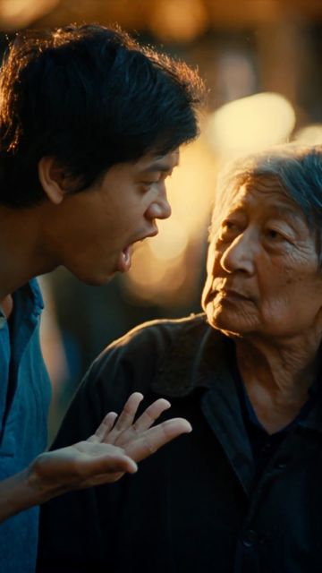</a> ▶ WanderBuddy_Travesty_reel.mp4 0:55 · 9:16</td></tr>
</table>

Also here: [`audio/`](travesty/audio) (3 files), [`HANDOFF.md`](travesty/HANDOFF.md), [`SCRIPT.md`](travesty/SCRIPT.md)

## Saved reels into a real plan

`reels/saved-reels-whatsapp/`  
Meme reel for the WhatsApp feature: forward the reels you saved and get a plan back. Two versions plus a short promo.

<table>
<tr><td align="center" valign="top" width="25%"><a href="saved-reels-whatsapp/final/promo_half.mp4">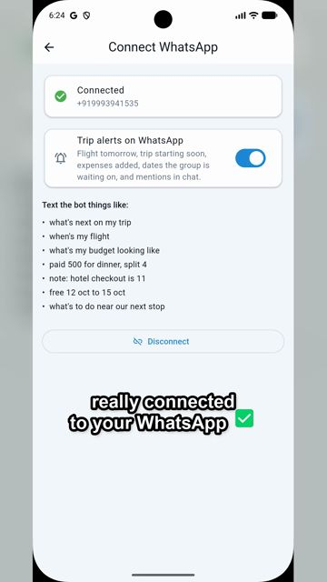</a> ▶ promo_half.mp4 0:15 · 9:16</td><td align="center" valign="top" width="25%"><a href="saved-reels-whatsapp/final/promo_half_no_outro.mp4">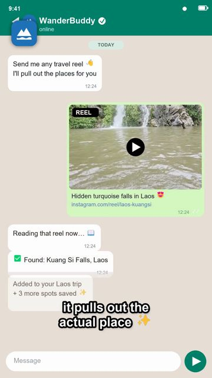</a> ▶ promo_half_no_outro.mp4 0:11 · 9:16</td><td align="center" valign="top" width="25%"><a href="saved-reels-whatsapp/final/recording_reframed_9x16.mp4">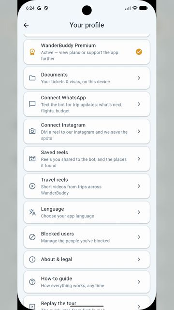</a> ▶ recording_reframed_9x16.mp4 0:15 · 9:16</td><td align="center" valign="top" width="25%"><a href="saved-reels-whatsapp/final/saved_reels_whatsapp_A.mp4">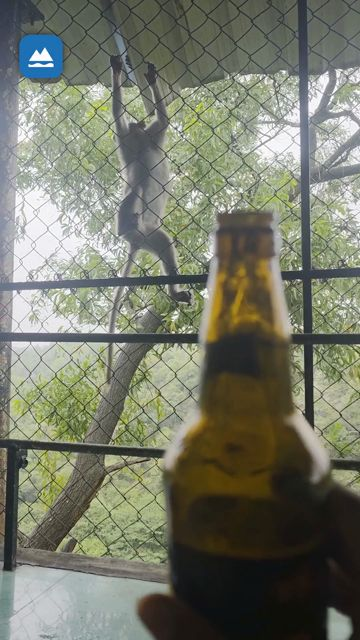</a> ▶ saved_reels_whatsapp_A.mp4 0:28 · 9:16</td></tr>
<tr><td align="center" valign="top" width="25%"> ▶ saved_reels_whatsapp_B.mp4 0:28 · 9:16</td></tr>
</table>

Also here: [`broll/`](saved-reels-whatsapp/broll) (13 files), [`captions/`](saved-reels-whatsapp/captions) (13 files), [`demo/`](saved-reels-whatsapp/demo) (7 files), [`promo/`](saved-reels-whatsapp/promo) (6 files), [`README.md`](saved-reels-whatsapp/README.md), [`src/`](saved-reels-whatsapp/src) (1 file)

## I could never overthink my trip

`reels/overthink-my-trip/`  
Meme reel, b-roll plus bold captions plus the end card.

<table>
<tr><td align="center" valign="top" width="25%"><a href="overthink-my-trip/overthink_my_trip.mp4">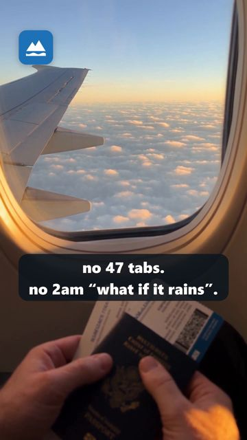</a> ▶ overthink_my_trip.mp4 0:20 · 9:16</td></tr>
</table>

Also here: [`clips/`](overthink-my-trip/clips) (3 files), [`README.md`](overthink-my-trip/README.md)

## Feature walkthrough

`reels/feature-walkthrough/`  
A 2:20 tour of the app, screen by screen.

<table>
<tr><td align="center" valign="top" width="25%"><a href="feature-walkthrough/final/WanderBuddy_Feature_Walkthrough.mp4">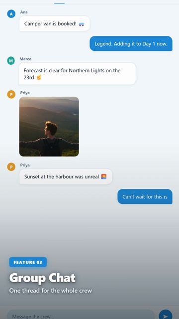</a> ▶ WanderBuddy_Feature_Walkthrough.mp4 2:20 · 9:16</td></tr>
</table>

Also here: [`broll/`](feature-walkthrough/broll) (5 files), [`clips/`](feature-walkthrough/clips) (12 files), [`SCRIPT.md`](feature-walkthrough/SCRIPT.md), [`ui/`](feature-walkthrough/ui) (109 files)

## The founder story

`reels/founder-story/`  
Why the founder built WanderBuddy, with word-by-word captions. The silent version is for re-scoring.

<table>
<tr><td align="center" valign="top" width="25%"><a href="founder-story/video_silent.mp4">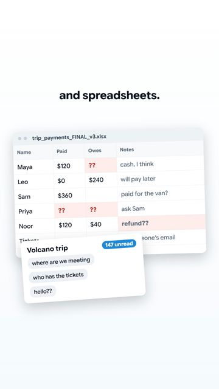</a> ▶ video_silent.mp4 1:10 · 9:16</td><td align="center" valign="top" width="25%"> ▶ WanderBuddy_founder_story.mp4 1:10 · 9:16</td></tr>
</table>

Also here: [`img/`](founder-story/img) (36 files), [`SCRIPT.md`](founder-story/SCRIPT.md)

## How we got to revenue

`reels/agency-story/`  
Why WanderBuddy went to travel agencies, told by the founder over his own footage. 71 s.

<table>
<tr><td align="center" valign="top" width="25%"><a href="agency-story/out/WanderBuddy_HowWeGotToRevenue.mp4">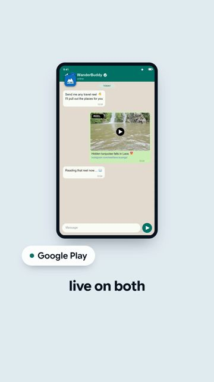</a> ▶ WanderBuddy_HowWeGotToRevenue.mp4 1:11 · 9:16</td></tr>
</table>

Also here: [`assets/`](agency-story/assets) (21 files), [`build/`](agency-story/build) (18 files), [`README.md`](agency-story/README.md)

## Trek UGC

`reels/ugc-trek/`  
UGC-style trek video.

<table>
<tr><td align="center" valign="top" width="25%"><a href="ugc-trek/wanderbuddy-trek-ugc.mp4">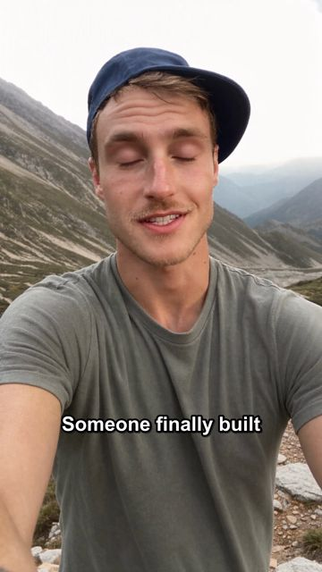</a> ▶ wanderbuddy-trek-ugc.mp4 0:32 · 9:16</td></tr>
</table>

## Group trip explainer

`reels/group-trip-explainer/`  
Short animated explainer, two lengths.

<table>
<tr><td align="center" valign="top" width="25%"><a href="group-trip-explainer/wanderbuddy-group-trip-9x16-v1.mp4">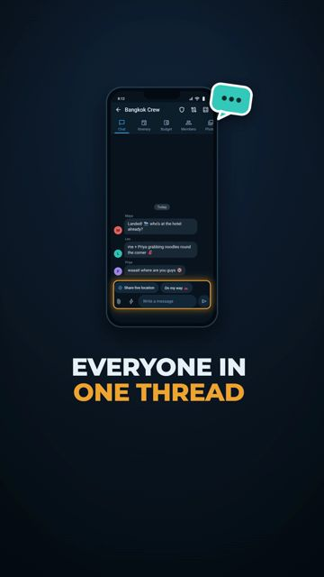</a> ▶ wanderbuddy-group-trip-9x16-v1.mp4 0:23 · 9:16</td><td align="center" valign="top" width="25%"><a href="group-trip-explainer/wanderbuddy-group-trip-9x16.mp4">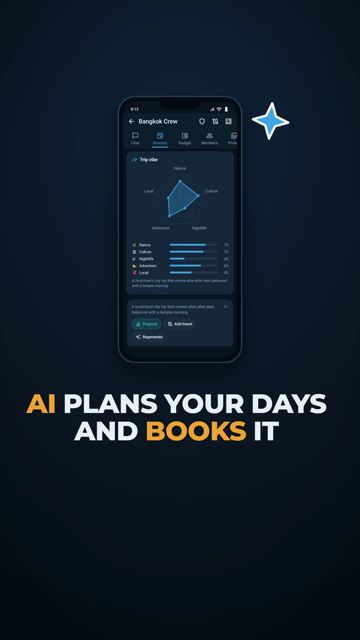</a> ▶ wanderbuddy-group-trip-9x16.mp4 0:31 · 9:16</td></tr>
</table>

Also here: [`NOTES.md`](group-trip-explainer/NOTES.md)

## Before and after

`reels/power-of-haircut/`  
Image pairs for a before and after meme format.

<table>
<tr><td align="center" valign="top" width="25%"><a href="power-of-haircut/pairs/01_home.png">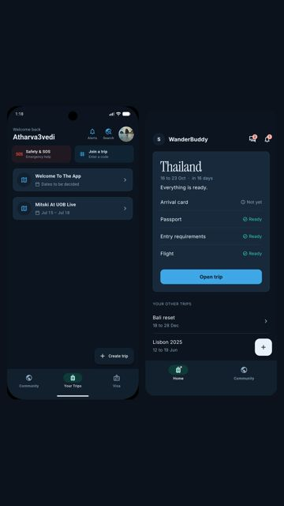</a> 01_home.png 9:16</td><td align="center" valign="top" width="25%"><a href="power-of-haircut/pairs/02_itinerary.png">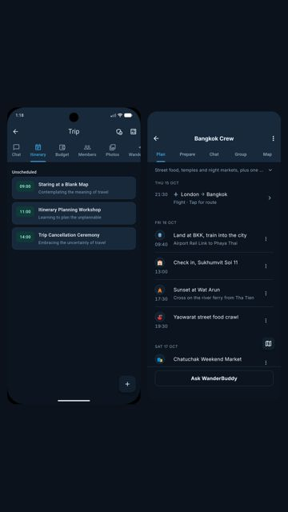</a> 02_itinerary.png 9:16</td><td align="center" valign="top" width="25%"><a href="power-of-haircut/pairs/03_budget.png">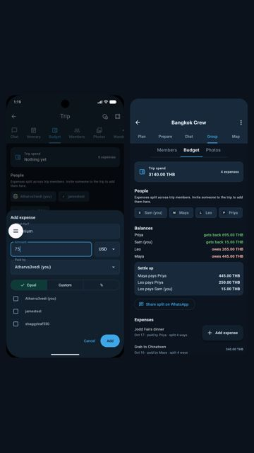</a> 03_budget.png 9:16</td><td align="center" valign="top" width="25%"><a href="power-of-haircut/pairs/04_visa_vs_prepare.png">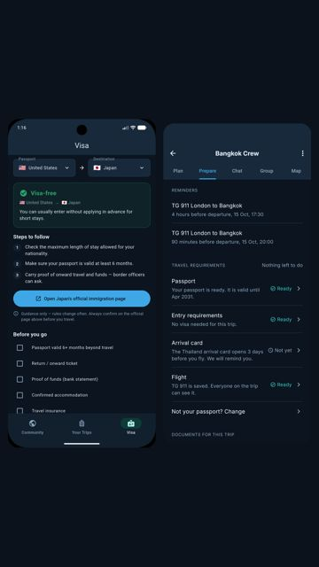</a> 04_visa_vs_prepare.png 9:16</td></tr>
<tr><td align="center" valign="top" width="25%"><a href="power-of-haircut/pairs/05_translate.png">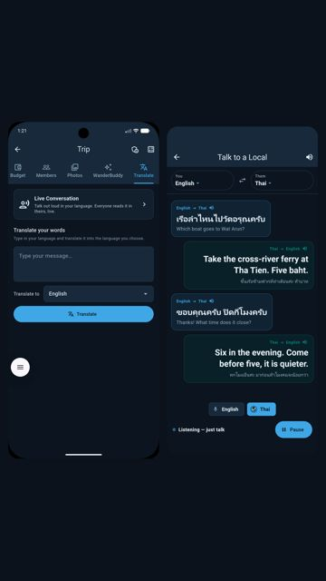</a> 05_translate.png 9:16</td><td align="center" valign="top" width="25%"><a href="power-of-haircut/pairs/06_ai_chat_vs_reels.png">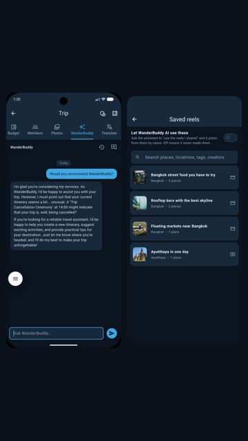</a> 06_ai_chat_vs_reels.png 9:16</td><td align="center" valign="top" width="25%"><a href="power-of-haircut/pairs/07_members_vs_vote.png">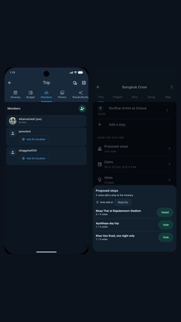</a> 07_members_vs_vote.png 9:16</td><td align="center" valign="top" width="25%"><a href="power-of-haircut/pairs/08_light_home_vs_map.png">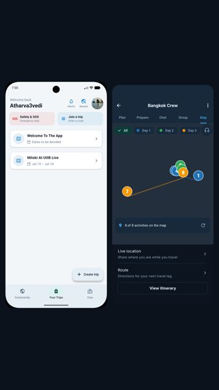</a> 08_light_home_vs_map.png 9:16</td></tr>
<tr><td align="center" valign="top" width="25%"><a href="power-of-haircut/pairs/bad_vs_new_01_home.png">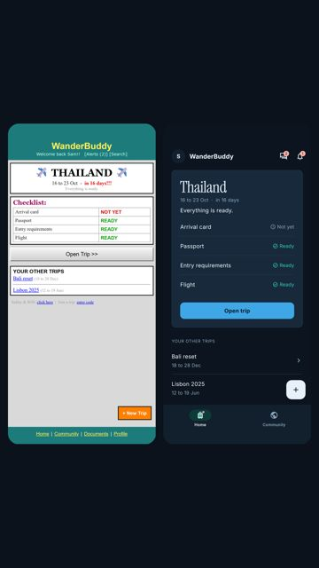</a> bad_vs_new_01_home.png 9:16</td><td align="center" valign="top" width="25%"><a href="power-of-haircut/pairs/bad_vs_new_02_plan.png">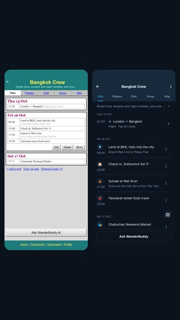</a> bad_vs_new_02_plan.png 9:16</td><td align="center" valign="top" width="25%"><a href="power-of-haircut/pairs/bad_vs_new_03_budget.png">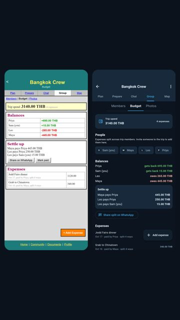</a> bad_vs_new_03_budget.png 9:16</td></tr>
</table>

Also here: [`after/`](power-of-haircut/after) (13 files), [`bad/`](power-of-haircut/bad) (5 files), [`before/`](power-of-haircut/before) (8 files), [`broken/`](power-of-haircut/broken) (3 files)

## Founder meme edits

`reels/founder-memes/`  
Made by the founder. They use clips from films, games and anime, so treat them as a tone reference and for organic posts only. Never run them as paid ads.

<table>
<tr><td align="center" valign="top" width="25%"><a href="founder-memes/just-wander.mp4">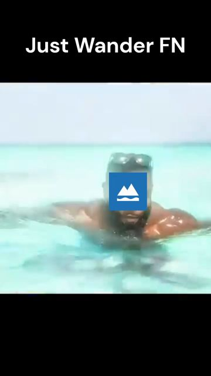</a> ▶ just-wander.mp4 0:13 · 9:16</td><td align="center" valign="top" width="25%"><a href="founder-memes/meme-after-hotel-check-in.mp4">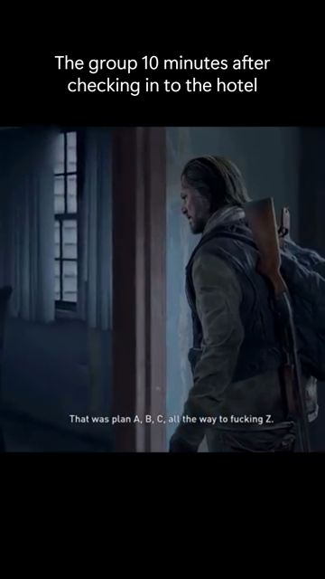</a> ▶ meme-after-hotel-check-in.mp4 0:25 · 9:16</td><td align="center" valign="top" width="25%"><a href="founder-memes/meme-anime-hidden-plan.mp4">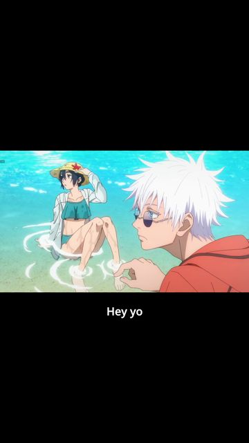</a> ▶ meme-anime-hidden-plan.mp4 3:31 · 9:16</td><td align="center" valign="top" width="25%"><a href="founder-memes/meme-arguing-over-plans.mp4">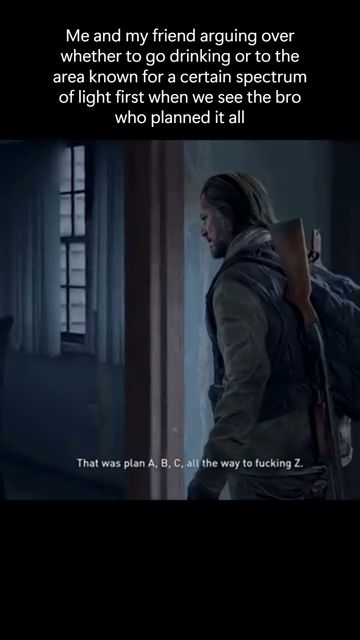</a> ▶ meme-arguing-over-plans.mp4 0:25 · 9:16</td></tr>
<tr><td align="center" valign="top" width="25%"> ▶ meme-sentry.mp4 0:26 · 9:16</td><td align="center" valign="top" width="25%"><a href="founder-memes/product-explainer.mp4">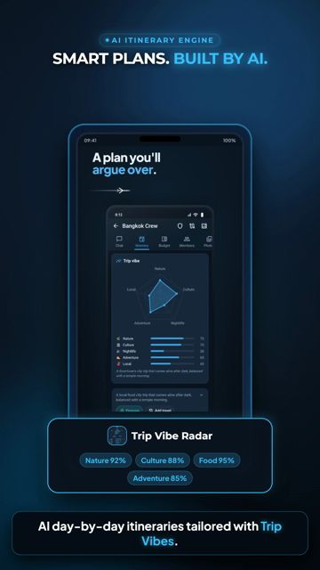</a> ▶ product-explainer.mp4 0:23 · 9:16</td></tr>
</table>
